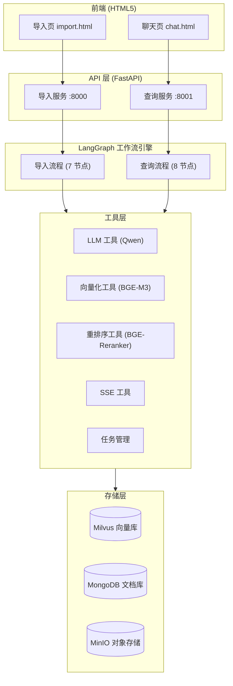
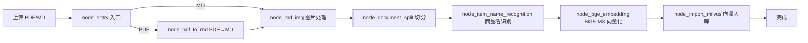
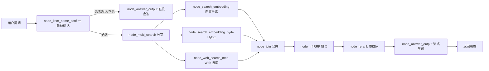

[README.md](https://github.com/user-attachments/files/33771318/README.md)
# 面向设备手册的RAG智能问答系统

> 面向垂直领域（产品手册 / 维修指南 / 技术文档）的企业级智能知识库与问答系统，融合
> **RAG（检索增强生成）** 技术，提供 "文档导入 → 知识构建 → 精准问答" 的完整闭环。

## 项目简介

本项目是一个基于 LangGraph 编排、以混合检索为核心的智能知识库系统。用户上传 PDF / Markdown 文档后，系统会自动完成解析、切分、向量化、入库；用户提问时，系统通过**三路并行召回 + 融合排序 + 重排序**，结合大模型生成带依据的流式回答。

适用于产品手册问答、技术文档检索、企业知识库、售后客服等场景。

## ✨ 功能特性


| 模块           | 说明                                              |
| ------------ | ----------------------------------------------- |
| **文档智能导入**   | 支持 PDF / Markdown 上传，自动解析、切分、向量化、入库             |
| **复杂文档解析**   | 基于 MineRu/MagicPDF 的 PDF→Markdown 转换，保留表格、公式、图片 |
| **商品名识别**    | LLM 自动抽取切片所属商品 / 型号，业务定制化召回                     |
| **多路混合召回**   | 向量检索 + HyDE + Web 搜索 三路并行                      |
| **RRF 融合排序** | Reciprocal Rank Fusion 合并多路结果，附断崖检测动态截断         |
| **智能重排序**    | BGE-Reranker-Large 精排，提升答案相关性                   |
| **流式问答**     | SSE 逐字推送，实时交互                                   |
| **会话历史管理**   | MongoDB 存储对话上下文，支持连续多轮对话                        |
| **可视化前端**    | 轻量 HTML5 导入页 + 聊天页，开箱即用                         |

## 🧠 系统架构




## 📁 目录结构


```
PythonProject16/

├── app/

│   ├── import\_process/              # 文档导入处理

│   │   ├── agent/                   # LangGraph 导入工作流

│   │   │   ├── main\_graph.py        # 导入流程图定义（7 节点）

│   │   │   ├── state.py             # 导入状态类型

│   │   │   └── nodes/               # 处理节点

│   │   │       ├── node\_entry.py            # 入口：参数初始化/校验

│   │   │       ├── node\_pdf\_to\_md.py        # PDF → Markdown

│   │   │       ├── node\_md\_img.py           # Markdown 图片处理

│   │   │       ├── node\_document\_split.py   # 文档切分

│   │   │       ├── node\_item\_name\_recognition.py  # 商品名识别

│   │   │       ├── node\_bge\_embedding.py    # BGE-M3 向量化

│   │   │       └── node\_import\_milvus.py    # 向量入库

│   │   ├── api/file\_import\_service.py  # 导入服务 (:8000)

│   │   └── page/import.html            # 导入前端页面

│   ├── query\_process/               # 知识查询处理

│   │   ├── agent/                   # LangGraph 查询工作流

│   │   │   ├── main\_graph.py        # 查询流程图定义（8 节点）

│   │   │   ├── state.py             # 查询状态类型

│   │   │   └── nodes/

│   │   │       ├── node\_item\_name\_confirm.py    # 商品确认

│   │   │       ├── node\_search\_embedding.py     # 向量检索

│   │   │       ├── node\_search\_embedding\_hyde.py# HyDE 检索

│   │   │       ├── node\_web\_search\_mcp.py       # Web 搜索 (MCP)

│   │   │       ├── node\_rrf.py                  # RRF 融合

│   │   │       ├── node\_rerank.py               # 重排序

│   │   │       └── node\_answer\_output.py        # 答案生成

│   │   ├── api/query\_service.py     # 查询服务 (:8001)

│   │   └── page/chat.html           # 聊天前端页面

│   ├── clients/                     # 外部存储客户端

│   │   ├── milvus\_utils.py          # Milvus 向量库操作

│   │   ├── minio\_utils.py           # MinIO 对象存储

│   │   └── mongo\_history\_utils.py   # MongoDB 会话历史

│   ├── conf/                        # 各类配置 (milvus/minio/llm/embedding...)

│   ├── core/                        # 日志、Prompt 加载等核心

│   ├── lm/                          # 大模型/向量化/重排序封装

│   ├── utils/                       # 通用工具（SSE、任务、格式化等）

│   └── tool/                        # 模型下载脚本

├── prompts/                         # Prompt 模板

├── doc/                             # 知识库源文档（PDF 示例，已被 .gitignore 排除）

├── test/                            # 测试代码

├── output/                          # 任务输出（已被 .gitignore 排除）

├── logs/                            # 运行日志（已被 .gitignore 排除）

├── pyproject.toml                   # 项目依赖声明

├── .env.example                     # 环境变量模板

└── .gitignore
```

## 🚀 快速开始

### 环境要求


| 项目     | 要求                                                       |
| ------ | -------------------------------------------------------- |
| Python | >= 3.11                                                  |
| CUDA   | GPU 推理所需（BGE-M3 + Reranker 建议独立 GPU）                     |
| 内存     | >= 16GB（建议 32GB）                                         |
| 显存     | >= 8GB                                                   |
| 存储     | >= 50GB（模型缓存）                                            |
| 依赖服务   | Milvus / MongoDB / MinIO（推荐 Docker Compose 一键部署） |

### 1. 克隆与安装依赖


```
git clone \<your-repo-url>.git

cd PythonProject16

\# 方式一：uv（推荐，仓库已锁定 uv.lock）

uv sync

\# 方式二：pip + venv

python -m venv .venv

\# Windows (PowerShell)

.venv\Scripts\Activate.ps1

\# Linux / macOS

source .venv/bin/activate

pip install -e . -i https://pypi.tuna.tsinghua.edu.cn/simple
```

> 若安装 PyTorch 遇到问题，请根据本地 CUDA 版本选择对应的 wheel 源单独安装：
> `pip install torch torchvision --index-url https://download.pytorch.org/whl/cu128`

### 2. 一键启动依赖中间件（Docker Compose）

仓库内可参考部署文档组织 `docker-compose.yml`（Etcd / MinIO / Milvus / Attu / MongoDB）：


```
docker compose up -d

docker compose ps
```

各服务默认端口：Milvus `19530`、MongoDB `27017`、MinIO `9000/9001`、Attu `7000`。

### 3. 下载本地模型（ModelScope）


```
\# BGE-M3 混合向量模型

python -c "from modelscope import snapshot\_download; snapshot\_download('BAAI/bge-m3')"

\# BGE-Reranker-Large 重排序模型

python -c "from modelscope import snapshot\_download; snapshot\_download('BAAI/bge-reranker-large')"
```

### 4. 配置环境变量


```
\# 复制模板并填写真实配置（API Key / 密码 / 模型路径等）

cp .env.example .env
```

`.env` 关键配置项（完整见 `.env.example`）：


| 类别   | 关键变量                                         | 说明                                  |
| ---- | -------------------------------------------- | ----------------------------------- |
| LLM  | `OPENAI_API_KEY` / `OPENAI_API_BASE`         | DashScope 兼容 OpenAI 格式的 API Key 与地址 |
| 模型   | `LLM_DEFAULT_MODEL` / `VL_MODEL`             | 默认 `qwen-flash` / `qwen3-vl-flash`  |
| 向量化  | `BGE_M3_PATH` / `BGE_DEVICE`                 | BGE-M3 本地路径与设备                      |
| 重排序  | `BGE_RERANKER_LARGE` / `BGE_RERANKER_DEVICE` | Reranker 路径与设备                      |
| 向量库  | `MILVUS_URL` / `CHUNKS_COLLECTION`           | Milvus 地址与集合名                       |
| 文档库  | `MONGO_URL` / `MONGO_DB_NAME`                | MongoDB 连接                          |
| 对象存储 | `MINIO_ENDPOINT` / `MINIO_BUCKET_NAME`       | MinIO 连接与桶名                         |

### 5. 启动服务


```
\# 导入服务（端口 8000）

python app/import\_process/api/file\_import\_service.py

\# 查询服务（端口 8001，另开一个终端）

python app/query\_process/api/query\_service.py
```

启动后访问：


* 导入页面：[http://localhost:8000/import.html](http://localhost:8000/import.html)

* 聊天页面：[http://localhost:8001/chat.html](http://localhost:8001/chat.html)

* 接口文档（Swagger）：[http://localhost:8000/docs](http://localhost:8000/docs) · [http://localhost:8001/docs](http://localhost:8001/docs)

## 🔌 API 接口

### 导入服务（:8000）


| 方法   | 路径                  | 说明                                 |
| ---- | ------------------- | ---------------------------------- |
| POST | `/upload`           | 上传文件（form-data，支持多文件，自动触发知识库导入全流程） |
| GET  | `/status/{task_id}` | 查询任务处理状态 / 已完成节点                   |
| GET  | `/import.html`      | 导入前端页面                             |

### 查询服务（:8001）


| 方法     | 路径                              | 说明                           |
| ------ | ------------------------------- | ---------------------------- |
| POST   | `/query`                        | 发起查询（`is_stream` 支持流式 / 非流式） |
| GET    | `/stream/{session_id}`          | SSE 流式获取答案                   |
| GET    | `/history/{session_id}?limit=N` | 获取会话历史                       |
| DELETE | `/history/{session_id}`         | 清除会话历史                       |
| GET    | `/health`                       | 健康检查                         |

### 查询示例


```
POST /query

Content-Type: application/json

{

&#x20; "query": "万用表如何测量直流电压？",

&#x20; "session\_id": "sess\_001",

&#x20; "is\_stream": false

}
```

流式模式响应示例（SSE）：


```
data: {"type": "delta", "data": {"delta": "测"}}

data: {"type": "delta", "data": {"delta": "量"}}

...

data: {"type": "final", "data": {"answer": "...", "status": "completed"}}
```

## 🔄 核心流程

### 文档导入流程




### 查询流程




## 🗄️ 数据存储设计


| 存储          | 用途    | 核心数据                                                      |
| ----------- | ----- | --------------------------------------------------------- |
| **Milvus**  | 向量数据库 | 文档切片（稠密向量 1024 维 + 稀疏向量）、商品名                       |
| **MongoDB** | 文档数据库 | 会话历史、改写后的查询与商品名                                           |
| **MinIO**   | 对象存储  | 源文件与文档图片持久化                                               |

## ⚙️ 技术栈


| 类别     | 技术                                            |
| ------ | --------------------------------------------- |
| 后端框架   | FastAPI + Uvicorn                             |
| 工作流引擎  | LangGraph / LangChain                         |
| 大语言模型  | 阿里云 DashScope（qwen-flash /qwen3-vl-flash）     |
| 向量嵌入   | BGE-M3（稠密 + 稀疏混合向量）+ OpenAI text-embedding-v4 |
| 重排序    | BGE-Reranker-Large（本地部署）                      |
| 向量数据库  | Milvus（HNSW / COSINE）                         |
| 文档数据库  | MongoDB                                       |
| 对象存储   | MinIO                                         |
| PDF 解析 | MineRu / MagicPDF                             |
| 前端     | 原生 HTML5 + JS（无框架）                            |

